<div align="center">


# Folio

**A fast, private reader for books, comics and manga.**

EPUB, Kindle, PDF, CBZ and CBR, FB2, Word, Markdown and text, on Windows, macOS and Linux.<br>
No account, no cloud, no tracking.

[](https://github.com/Aksharan1/folio-reader/actions/workflows/ci.yml)
[](https://github.com/Aksharan1/folio-reader/releases/latest)

[](LICENSE)

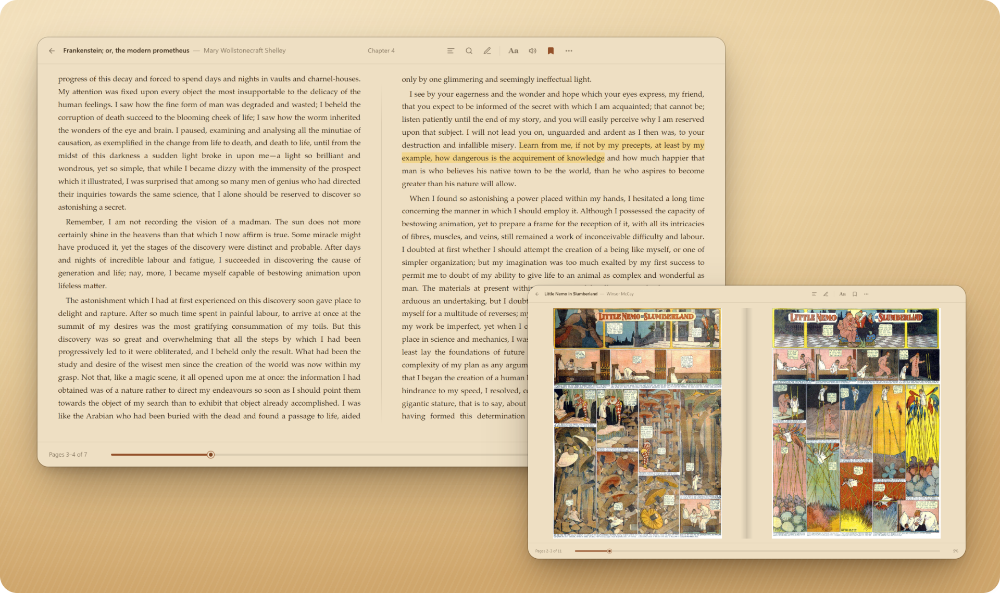

**[⬇ Download for Windows, Mac or Linux](#download)** · [Features](#features) · [Manga and comics](#manga-and-comics) · [Formats](#supported-formats) · [Shortcuts](#keyboard-shortcuts) · [Build from source](#building-from-source)

</div>

## Why Folio

|  |  |  |
| --- | --- | --- |
| 📖 **Reads like a book**<br>Two pages side by side, page turns that never cut a line in half, and a warm Sepia page that's easy on the eyes. | 🎌 **Manga, the right way round**<br>Comics open as full pages. Manga reads right to left, with spreads paired like the printed volume. | 🔒 **Yours alone**<br>No account and no telemetry. Your library, progress and notes stay on your computer. |
| 🗂 **Every format you own**<br>EPUB, MOBI and AZW3, PDF (even scanned ones), CBZ, CBR, FB2, Word, Markdown and text. | ✍️ **Notes that travel**<br>Highlights in five colours, notes and bookmarks. Import Kindle highlights, export Markdown. | 🔊 **Look up and listen**<br>Define any word from Wiktionary, or have the book read to you in a natural voice while the pages turn. |

## Download

Pick your computer. One file, then one step.

<p align="center">
  <a href="https://github.com/Aksharan1/folio-reader/releases/latest/download/Folio-Setup-Windows.exe"></a>
  &nbsp;
  <a href="https://github.com/Aksharan1/folio-reader/releases/latest/download/Folio-macOS.dmg"></a>
  &nbsp;
  <a href="https://github.com/Aksharan1/folio-reader/releases/latest/download/Folio-Linux.deb"></a>
</p>

| Your computer | Then |
| --- | --- |
| **Windows 10 or 11** | Double-click **Folio-Setup-Windows.exe**. Folio installs and opens by itself, with a shortcut on your desktop and in the Start menu. |
| **Mac** (Apple silicon or Intel, macOS 12 or newer) | Open **Folio-macOS.dmg** and drag Folio into Applications. Then open it from Launchpad. |
| **Ubuntu, Debian, Mint** | Double-click **Folio-Linux.deb** to install it with your software centre, then find Folio in your apps. |
| **Other Linux** | Download **[Folio-Linux.AppImage](https://github.com/Aksharan1/folio-reader/releases/latest/download/Folio-Linux.AppImage)**, allow it to run as a program (right-click → Properties), then double-click it. |

Folio isn't signed by Microsoft or Apple yet, so the very first launch asks once:

- **Windows:** if SmartScreen appears, choose **More info → Run anyway**.
- **Mac:** if macOS says it can't check Folio, open **System Settings → Privacy & Security** and choose **Open Anyway**.

Want it on a USB stick? **[Folio-Portable-Windows.exe](https://github.com/Aksharan1/folio-reader/releases/latest/download/Folio-Portable-Windows.exe)** runs without installing and keeps its library in a `Folio Data` folder beside it. Every version is on the [Releases page](https://github.com/Aksharan1/folio-reader/releases).

### First launch

Folio opens on a short welcome: its book swings open, you pick the page you like to read on and watch the whole app change to it, then bring in your books, a whole folder, or a free classic to start with.

<table>
  <tr>
    <td width="50%">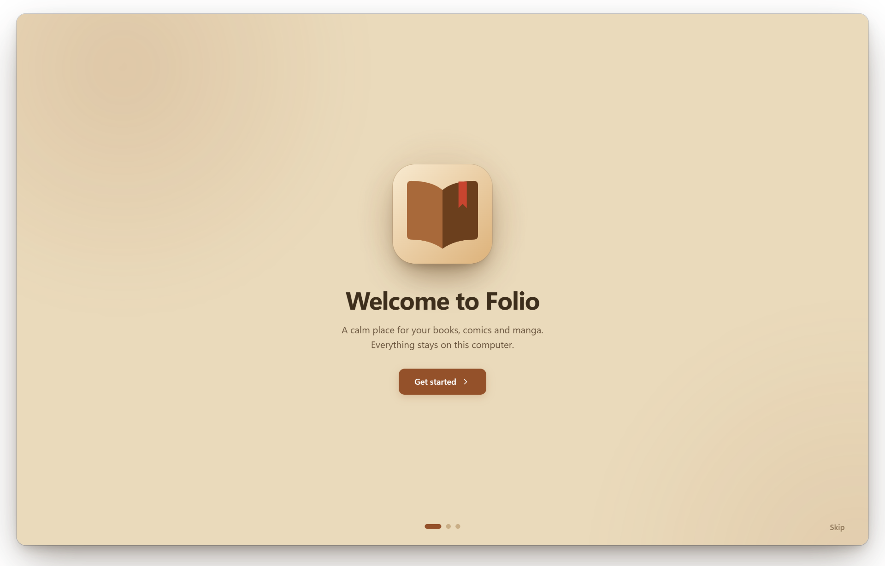</td>
    <td width="50%">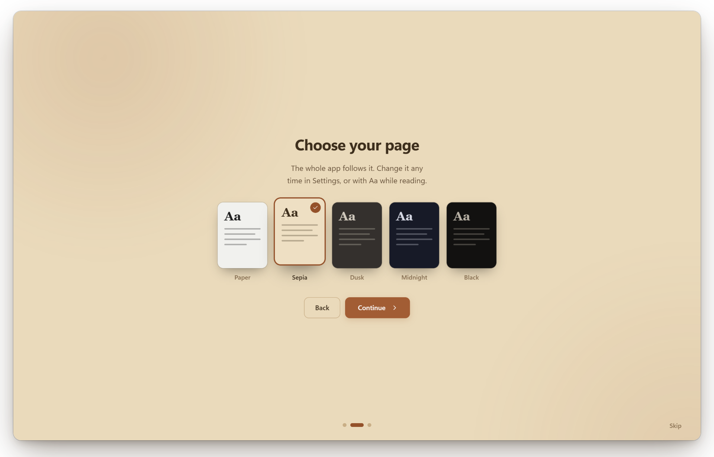</td>
  </tr>
</table>

## Features

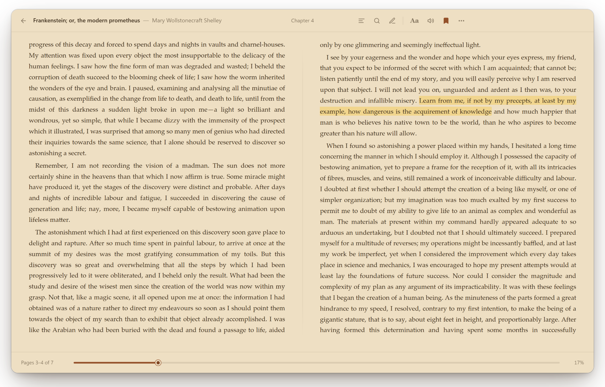

**Reading**
- Pages break between lines, so no line is ever cut in half or shown twice.
- Two pages side by side on wide windows, like an open book.
- Five themes with a brightness control, 11 fonts, and adjustable text size, line spacing, margins and alignment.
- **Read aloud** in a natural voice that runs on your computer (Kokoro, downloaded once, about 175 MB), or with your system's voices. It follows along, turning pages and moving through chapters, and gets the next sentence ready while it speaks, so there are no gaps.
- **Look up** any word for a definition from Wiktionary, or a Wikipedia summary for names and places.
- Footnotes open in a popup next to the text. Links inside a book work, and web links open in your browser.
- Full-text search in the book, a contents panel, a progress scrubber, and an estimate of the time left.

**Notes**
- Highlights in five colours, notes on any passage, and bookmarks, collected per book and across your library.
- Export highlights and notes as Markdown, for one book or all of them.
- Bring over your Kindle highlights by importing `My Clippings.txt`.

**Library**
- Add books one at a time, a whole folder, or by dragging them onto the window.
- Grid and list views, filters, sorting, favourites, an author index, and a Reading Now page.
- Back up the whole library (books, progress, highlights and bookmarks) to a single file and restore it on another computer, even one running a different system.

<table>
  <tr>
    <td width="50%">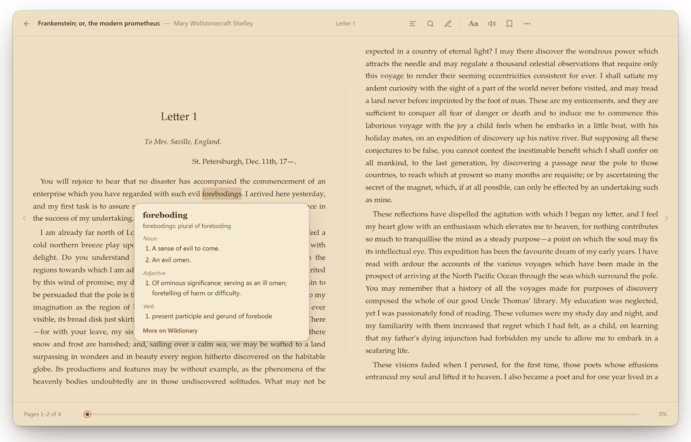</td>
    <td width="50%">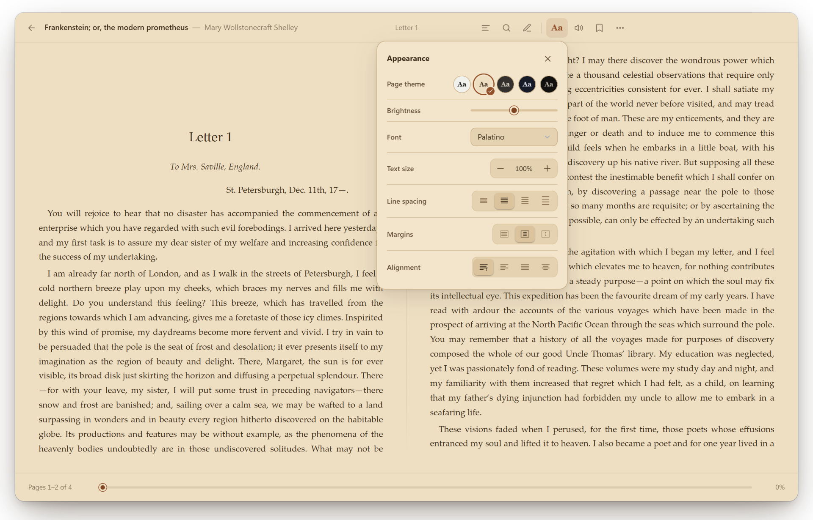</td>
  </tr>
  <tr>
    <td>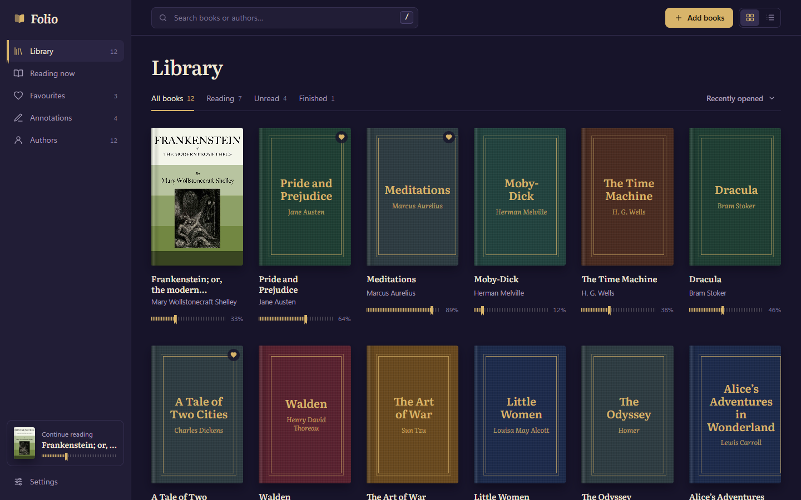</td>
    <td>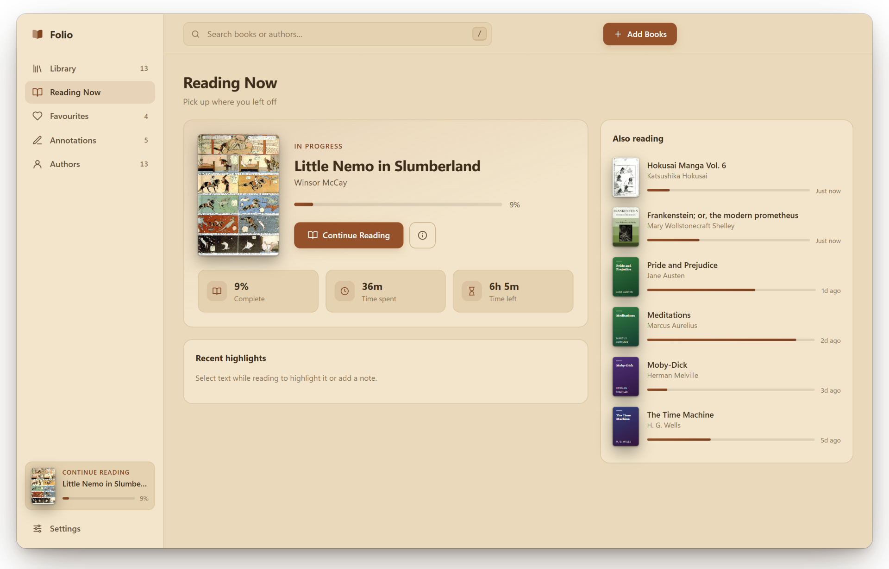</td>
  </tr>
  <tr>
    <td>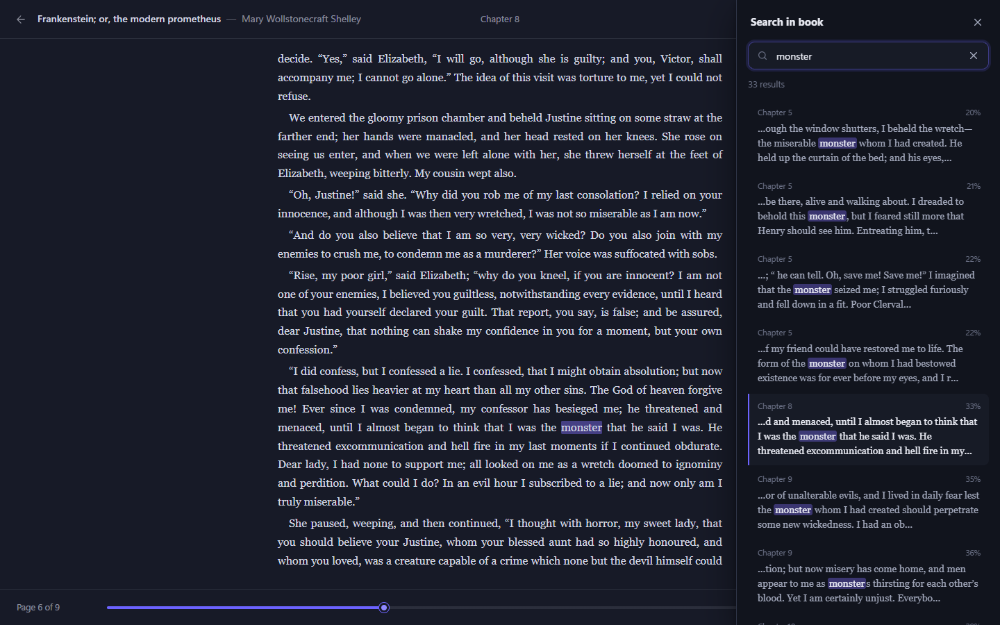</td>
    <td>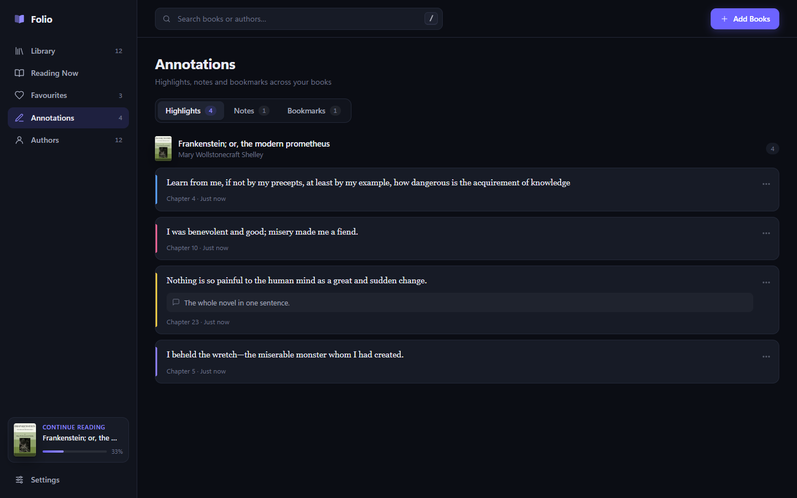</td>
  </tr>
</table>

### Five themes

Paper, **Sepia**, Dusk, Midnight and Black. Each one restyles the whole app as well as the page, and the brightness slider fine-tunes it.

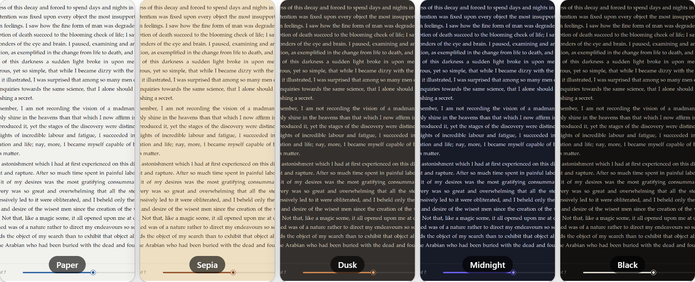

## Manga and comics


- **CBZ, CBR and CBT** open with one picture per page, fitted to the window.
- **Right to left for manga.** Folio reads `ComicInfo.xml` to tell manga from western comics. Press **D** to switch direction for any book. In a right-to-left book, **←** turns to the next page and the first page of each pair sits on the right.
- **Two-page spreads, as printed.** The cover stands alone, then pages pair up. Double-page artwork gets the whole window.
- **Fit to width** for tall pages and webtoons, scrolling down one screen at a time.
- **Page thumbnails** in the contents panel. Jump anywhere at a glance.
- **Scanned PDFs**, and comics or manga saved as PDF, open as page pictures too.

<table>
  <tr>
    <td width="50%">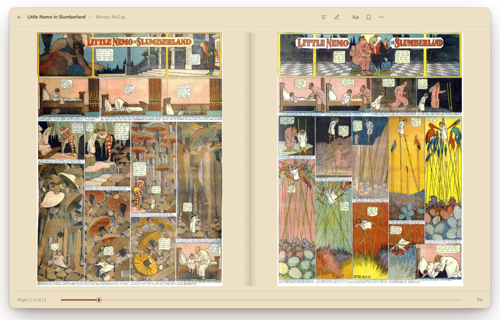</td>
    <td width="50%">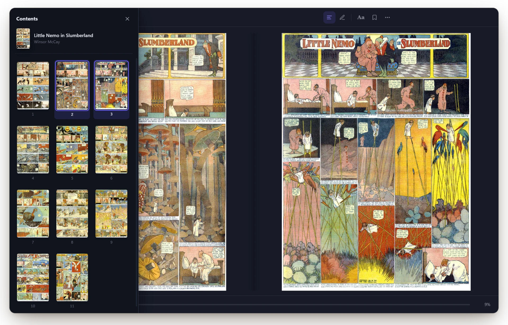</td>
  </tr>
</table>

## Supported formats

Folio's reader works with EPUB. Other formats are converted to EPUB on your computer when you add them, so progress, bookmarks and (for text) search and highlights work the same for every book. The original file isn't kept.

| Format | Notes |
| --- | --- |
| EPUB | Opened as-is, including fixed-layout manga and picture books. |
| MOBI, AZW, AZW3, PRC | Kindle books, both the old MOBI and the newer KF8 (AZW3) format, with images, styles and the table of contents. DRM-protected books and KFX files can't be opened. Parsed with [foliate-js](https://github.com/johnfactotum/foliate-js). |
| CBZ, CBR, CBT | Comics and manga (zip, RAR and tar archives of pages). Title, author and reading direction come from `ComicInfo.xml` when there is one, and each folder of pages becomes a chapter. CB7 isn't supported yet. |
| PDF | The text is extracted and reflowed into paragraphs, so it adapts to your font and theme settings. Headers, footers and page numbers are removed, and the PDF's outline becomes the contents. Images, tables and complex layouts don't come through. A PDF without a text layer (a scan, a comic) is kept as page pictures instead. Uses [pdf.js](https://mozilla.github.io/pdf.js/). |
| FB2, FBZ, FB2.ZIP | FictionBook, including cover, images, poems, epigraphs and footnotes. |
| DOCX | Word documents: headings (which become chapters), bold, italic, lists, tables, links and images. |
| HTML, HTM, XHTML | Split into chapters at `<h1>`/`<h2>` headings. Embedded (`data:`) images are kept, and scripts and external files are dropped. |
| MD, Markdown | Headings, emphasis, lists, quotes, code and links. |
| TXT | Paragraphs are rejoined, and chapter headings such as "Chapter IV" or "Part Two" become the contents. |

## Keyboard shortcuts

On a Mac, use **⌘** wherever this says Ctrl.

| Reading | | Library | |
| --- | --- | --- | --- |
| `→` `Space` `PgDn` | Next page | `Ctrl O` | Add books |
| `←` `PgUp` | Previous page | `Ctrl Shift O` | Add a folder |
| `Home` / `End` | Beginning / end of book | `/` or `Ctrl F` | Search library |
| `T` | Contents | `Esc` | Clear search |
| `F` or `Ctrl F` | Search in book | `F11` | Full screen |
| `A` | Annotations | `Ctrl +` / `Ctrl -` | Zoom the whole app |
| `S` | Appearance | | |
| `R` | Read aloud | | |
| `B` | Toggle bookmark | | |
| `H` | Highlight selected text | | |
| `I` | Book details | | |
| `+` / `-` | Text size | | |
| `D` | Switch reading direction (comics and manga) | | |
| `Esc` | Close panel, stop reading aloud | | |

In a right-to-left manga, `←` is the next page and `→` the previous one, the way the book reads.

## Privacy

- Everything stays on your computer. There's no account, telemetry or sync server.
- Folio only goes online when you look up a word, and once to download the natural voice if you ask for it.
- A book can't run scripts or load anything from the internet.

## Where your data lives

| System | Library folder |
| --- | --- |
| Windows | `%APPDATA%\Folio` (the portable app: `Folio Data` next to the .exe) |
| macOS | `~/Library/Application Support/Folio` |
| Linux | `~/.config/Folio` |

To move to another computer, use **Settings → Library & Data → Back up library**, then **Restore a backup** on the new one.

## Building from source

You need [Node.js](https://nodejs.org/) 22.13 or newer, on Windows, macOS or Linux.

```bash
git clone https://github.com/Aksharan1/folio-reader.git
cd folio-reader
npm install
npm start            # run the app from source
npm test             # end-to-end test: opens the app and drives it for a couple of minutes
npm run dist         # build installers for the system you're on, into dist/
```

`npm run dist` makes the Windows installer and portable app on Windows, the DMG on a Mac, and the AppImage and .deb on Linux. Pushing a version tag (`git tag v1.2.0 && git push --tags`) has GitHub Actions build all of them and publish a release.

If `npm start` reports that Electron failed to install, run `node node_modules/electron/install.js` once. On Linux without a display (CI), run the tests with `xvfb-run -a npm test`.

Other scripts:

```bash
npm run screenshots  # rebuild docs/screenshots (looks up one word on Wiktionary)
npm run vendor       # refresh vendor/ from node_modules after updating epub.js, JSZip, pdf.js, foliate-js or node-unrar-js
npm run icon         # redraw build/icon.png from the favicon in index.html
npm run dmg-background  # redraw the Mac disk image window (build/dmg-background*.png)
```

Set `SHOTS=some/folder` when running `npm test` to save a screenshot of every step.

## How it works

Folio is plain HTML, CSS and JavaScript with no framework and no build step, inside a small [Electron](https://www.electronjs.org/) shell.

Each spine section of the EPUB is rendered by [epub.js](https://github.com/futurepress/epub.js) to HTML, and loaded into a sandboxed `<iframe>` with the theme injected as CSS. Once the section's layout is final, the iframe measures every line box and cuts pages between lines. Turning a page scrolls to the next cut. A strip under the last full line is masked, so a partly visible line is never shown. In the two-page view, a second iframe shows the page after the first.

Comics are EPUBs too: each page picture is its own section. When a book turns out to be made of pictures, the reader swaps in a bare page that fits the picture to the window, counts progress in pages, and in the two-page view puts two sections side by side, in reading order.

Progress is measured in characters across the whole book. Highlights are stored as the text you selected, and drawn again by finding that text each time a section renders. Books are stored in IndexedDB inside the app's profile.

Each page frame carries a Content-Security-Policy that only lets Folio's own script run, so scripts inside a book are blocked.

```
index.html            entry point and Content-Security-Policy
app.css               design tokens, themes, layout and components
js/
  dom.js              tiny DOM helper, icon set, generated covers, formatters
  convert.js          converts MOBI/AZW3, PDF, comics, FB2, DOCX, HTML, Markdown and text to EPUB
  reader.js           rendering engine: pagination, two-page view, comics, links, search, highlights
  library.js          IndexedDB storage, preferences, backup and restore
  clippings.js        imports Kindle highlights from My Clippings.txt
  speech.js           read aloud
  lookup.js           Wiktionary and Wikipedia look-ups
  app.js              UI: library views, reader chrome, panels, keyboard
electron/
  main.js             desktop shell: window, menus, app:// protocol, file opening, save dialogs
  preload.js          the small bridge between the shell and the page
vendor/               epub.js, JSZip, pdf.js, foliate-js's MOBI parser and node-unrar-js (pre-built)
samples/              a public-domain sample book
build/icon.png        app icon
scripts/              screenshot, icon, disk image and vendor helpers
tests/                end-to-end test, the launcher it uses, and a small CBR fixture
```

## Contributing

Bug reports, ideas and pull requests are welcome. See [CONTRIBUTING.md](CONTRIBUTING.md). Folio aims to stay small, so please open an issue to talk about a feature before building it.

## Credits

- [epub.js](https://github.com/futurepress/epub.js) (BSD-2-Clause) and [JSZip](https://stuk.github.io/jszip/) (MIT) do the EPUB parsing.
- [pdf.js](https://github.com/mozilla/pdf.js) (Apache-2.0) reads PDFs, and [foliate-js](https://github.com/johnfactotum/foliate-js) (MIT) reads Kindle books.
- The natural voice is [Kokoro-82M](https://huggingface.co/hexgrad/Kokoro-82M) (Apache-2.0), run with [ONNX Runtime](https://onnxruntime.ai/) (MIT). Its text clean-up follows [kokoro-js](https://github.com/hexgrad/kokoro) (Apache-2.0), and words become sounds with [eSpeak NG](https://github.com/espeak-ng/espeak-ng) (GPL-3.0) through [phonemizer](https://github.com/xenova/phonemizer.js).
- [node-unrar-js](https://github.com/YuJianrong/node-unrar.js) (MIT), built from RARLAB's [UnRAR](https://www.rarlab.com/rar_add.htm) source (freeware licence), opens CBR comics.
- Definitions come from [Wiktionary](https://www.wiktionary.org/), and summaries from [Wikipedia](https://www.wikipedia.org/) (CC BY-SA).
- The sample book, *Frankenstein* by Mary Wollstonecraft Shelley, comes from [Project Gutenberg](https://www.gutenberg.org/ebooks/84).
- The other books in the screenshots are tiny demo files built by `scripts/screenshots.mjs` from public-domain opening lines.
- The comics in the screenshots are in the public domain, from Wikimedia Commons: *Little Nemo in Slumberland* by Winsor McCay (New York Herald, 1905), and volume 6 of the *Hokusai Manga* by Katsushika Hokusai (1817), photographed by the [Metropolitan Museum of Art](https://www.metmuseum.org/) (CC0). The screenshot script downloads them; they aren't stored in this repository.

## Licence

[MIT](LICENSE) for Folio's own code. The installers also carry eSpeak NG, under the GPL-3.0, for the natural voice's pronunciation; its source is at [github.com/espeak-ng/espeak-ng](https://github.com/espeak-ng/espeak-ng).
