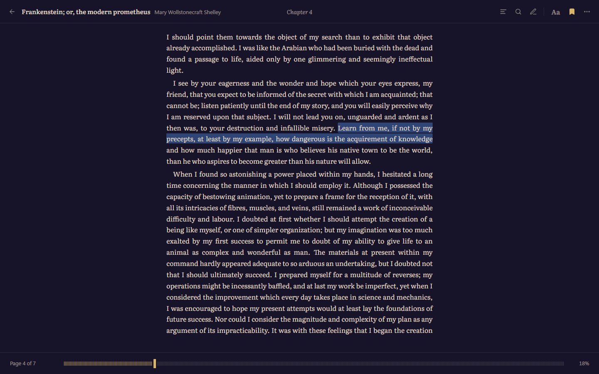
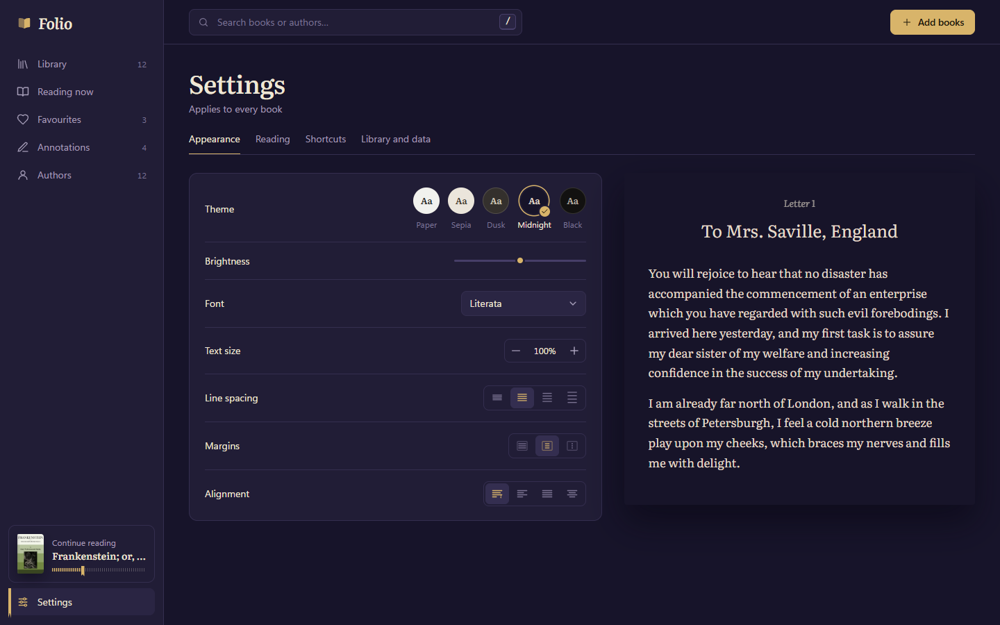

# Folio

**A fast, private EPUB reader that runs entirely in your browser.**
No accounts, no uploads, no build step. Your books, progress and highlights stay on your device.


## Features

- **Library**: grid and list layouts, filters (reading, unread, finished), sorting, instant search, favourites, and a browsable author index. Books without cover art get a generated cover.
- **Distraction-free reader**: paginated pages that break between lines, so no line appears twice. A page-turn animation (can be switched off), click or keyboard navigation, and a progress scrubber.
- **Appearance**: five themes (Paper, Sepia, Dusk, Midnight, Black), brightness, 12 fonts (including the bundled Literata, a typeface designed for e-reading), text size, line spacing, margins and alignment, with a live preview.
- **Highlights & notes**: select text to highlight it in one of five colours, attach notes, and copy passages. Everything is collected per book and across your library.
- **Bookmarks**: one keypress saves the page you're on.
- **Full-text search**: finds every match in the book with context, and takes you to the exact occurrence.
- **Reading Now**: pick up where you left off, with time spent and an estimate of the time left.
- **Works offline**: all data lives in IndexedDB and `localStorage`. Nothing leaves the browser.

<table>
  <tr>
    <td></td>
    <td></td>
  </tr>
  <tr>
    <td></td>
    <td></td>
  </tr>
  <tr>
    <td></td>
    <td></td>
  </tr>
</table>

## Getting started

Folio is plain HTML, CSS and JavaScript, so there is nothing to compile.

```bash
git clone <your-repo-url> folio
cd folio
npm start            # serves the app at http://localhost:8080
```

`npm start` only needs Node.js 18+. No `npm install` is required to run the app. You can also open `index.html` directly from disk. Everything works that way except the bundled **Try a sample book** button, because browsers block `fetch` on `file://` pages.

Add books with **Add books**, or drag `.epub` files onto the window.

## Keyboard shortcuts

| Reading | | Library | |
| --- | --- | --- | --- |
| `→` `Space` `PgDn` | Next page | `/` or `Ctrl F` | Search library |
| `←` `PgUp` | Previous page | `Esc` | Clear search |
| `Home` / `End` | Beginning / end of book | | |
| `T` | Contents | | |
| `F` or `Ctrl F` | Search in book | | |
| `A` | Annotations | | |
| `S` | Appearance | | |
| `B` | Toggle bookmark | | |
| `H` | Highlight selected text | | |
| `I` | Book details | | |
| `+` / `-` | Text size | | |
| `Esc` | Close panel | | |

## Project structure

```
index.html            entry point
app.css               design tokens, layout and components
js/
  dom.js              tiny DOM helper, icon set, generated covers, formatters
  reader.js           rendering engine: themes, pagination, search, annotations
  library.js          IndexedDB storage, preferences, library queries
  app.js              UI: library views, reader chrome, panels, keyboard
vendor/               epub.js and JSZip (pre-built, loaded with <script>)
fonts/                Literata, bundled so the app works offline
samples/              a public-domain sample book
scripts/serve.mjs     zero-dependency static server (npm start)
scripts/screenshots.mjs  regenerates the README screenshots
tests/smoke.mjs       end-to-end test in headless Chrome
```

### How the reader works

Each spine section of the EPUB is rendered by [epub.js](https://github.com/futurepress/epub.js) to HTML and loaded into a sandboxed `<iframe>`, with the theme injected as CSS. Once the section's layout is final, the iframe measures every line box and cuts pages between lines. Turning a page scrolls to the next cut. A strip under the last full line is masked, so a partially visible line is never shown. Progress is measured in characters across the whole book. Highlights are re-applied by matching their text each time a section renders.

## Development

```bash
npm install            # dev tools only: Puppeteer, plus epub.js and JSZip sources
npm test               # end-to-end smoke test in headless Chrome
npm run screenshots    # rebuild docs/screenshots
npm run vendor         # refresh vendor/ from node_modules
```

Set `SHOTS=some/folder` when running `npm test` to save a screenshot of every step.

Folio has been developed and tested in Chromium-based browsers. It relies on modern CSS (`color-mix()` and container queries), so it needs a current version of Chrome, Edge, Firefox or Safari.

## Credits

- [epub.js](https://github.com/futurepress/epub.js) (BSD-2-Clause) and [JSZip](https://stuk.github.io/jszip/) (MIT) do the EPUB parsing.
- [Literata](https://github.com/googlefonts/literata) by TypeTogether is bundled in `fonts/` under the SIL Open Font License (`fonts/OFL-Literata.txt`).
- The sample book, *Frankenstein* by Mary Wollstonecraft Shelley, comes from [Project Gutenberg](https://www.gutenberg.org/ebooks/84).
- The other titles in the README screenshots are tiny demo files built by `scripts/screenshots.mjs` from public-domain opening lines.

## License

[MIT](LICENSE)
